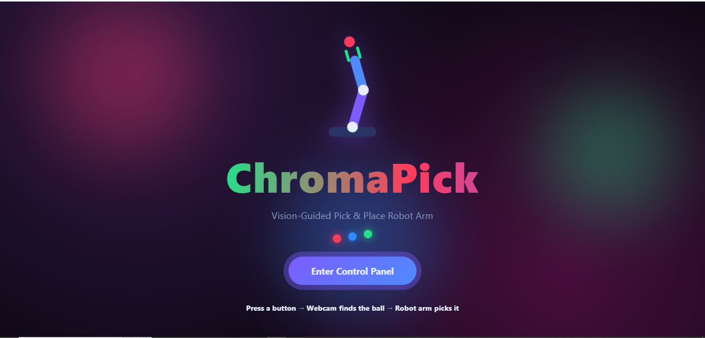
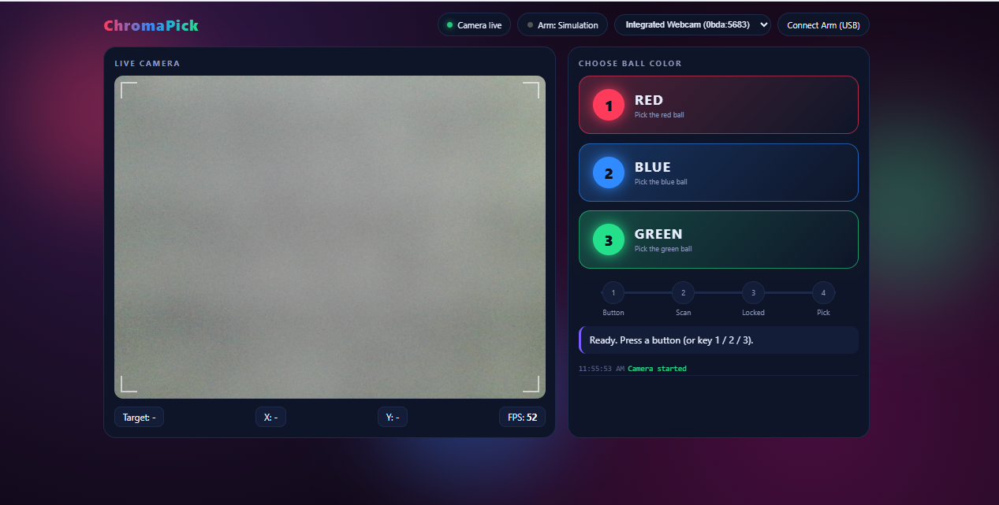
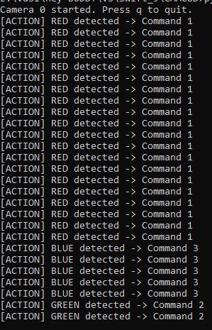

# ChromaPick: Vision-Guided Pick & Place Robot Arm

Press a color button (**Red / Blue / Green**), the webcam finds the ball of that color, and an **Arduino-controlled robot arm** picks it up and drops it in the matching zone.

A browser dashboard (HTML + JavaScript) does the live color detection and sends the ball position to the Arduino over USB serial. No cloud, no extra libraries in the browser.

---

## Features

- Animated welcome page and control panel (pure HTML / CSS / JavaScript, single file)
- Live webcam feed with real-time Red, Green and Blue ball detection (HSV color space)
- 3 animated buttons: **1 = Red, 2 = Blue, 3 = Green** (keyboard keys `1` `2` `3` also work)
- Only the **selected color** is targeted, other colors are ignored
- Stable lock (ball must be seen for 8 frames in a row) before the arm is triggered
- Sends ball position to the arm over USB serial (Web Serial API)
- Works with the arm's **physical buttons** too (`BTN1` / `BTN2` / `BTN3`)
- **Simulation mode** when no arm is connected (test the whole flow without hardware)
- Camera selector (laptop webcam or external USB webcam)
- Optional Python (OpenCV) versions of the detector for terminal testing

---

## How it works

```
Button press (web page or arm)
        |
        v
Target color set (RED / BLUE / GREEN)
        |
        v
Webcam frame -> shrink -> RGB to HSV -> classify pixels -> find ball center (x, y)
        |
        v
Ball stable for 8 frames -> lock position
        |
        v
Browser sends  "PICK,BLUE,300,200"  over USB serial
        |
        v
Arduino maps pixel (x, y) -> servo angles -> picks ball -> drops in color zone
        |
        v
Arduino replies "DONE"  -> ready for next button
```

### Serial protocol (115200 baud)

| Message | Direction | Meaning |
|---|---|---|
| `BTN1` / `BTN2` / `BTN3` | Arduino -> PC | Physical button pressed |
| `PICK,RED,320,240` | PC -> Arduino | Color, ball x, ball y (camera pixels, 640x480 frame) |
| `NOTFOUND,RED` | PC -> Arduino | Ball not seen within 6 seconds |
| `DONE` | Arduino -> PC | Pick finished |

---

## Project structure

```
CAMCOD
├── index.html                    # Main web app (welcome page + control panel)
├── robot_arm_uno/
│   └── robot_arm_uno.ino         # Arduino sketch (buttons + 4 servos + pick logic)
├── robot_arm_vision.py           # Optional: Python/OpenCV version of the vision + serial side
├── color_detector.py             # Optional: simple R/G/B detection test
└── README.md
```

---

## Hardware

| Part | Notes |
|---|---|
| Arduino Uno / ATmega328P | Uno board has USB built in. A bare DIP chip needs a USB-serial adapter (CH340 / FTDI) |
| 4 servos | Base, shoulder, elbow, gripper |
| 3 push buttons | Red, Blue, Green |
| USB webcam | Laptop webcam or external (e.g. Logitech) |
| External 5-6 V supply (2 A+) | **Power servos from this, not from the Arduino 5 V pin** |
| Colored balls | Red, Blue, Green |

### Wiring

| Part | Arduino pin |
|---|---|
| Button 1 (Red) | D2 to GND |
| Button 2 (Blue) | D3 to GND |
| Button 3 (Green) | D4 to GND |
| Base servo | D9 |
| Shoulder servo | D10 |
| Elbow servo | D11 |
| Gripper servo | D6 |
| Status LED | D13 (built-in) |

- Buttons use `INPUT_PULLUP`, so no resistors are needed.
- Join the external supply **GND** with the Arduino **GND**.
- Do not use pins D0 / D1 (USB serial).

---

## Setup

### 1. Arduino

1. Open `robot_arm_uno/robot_arm_uno.ino` in the Arduino IDE.
2. Board: **Arduino Uno**, select the correct COM port.
3. Upload.
4. Close the Serial Monitor (only one program can use the COM port).

### 2. Web app

Run a local server in the project folder (camera and USB permissions work best on `localhost`):

```bash
py -m http.server 8000
```

Open **http://localhost:8000** in **Chrome or Edge** (Web Serial is not supported in Firefox / Safari).

1. Click **Enter Control Panel** and allow camera access.
2. Click **Connect Arm (USB)** and choose the Arduino COM port. The pill turns to **Arm: Connected**.
3. Place the balls in the camera view and press button **1 / 2 / 3**.

If no arm is connected the page runs in **simulation mode** and logs the `PICK` message it would send.

### 3. Python version (optional)

```bash
pip install opencv-python numpy pyserial

py robot_arm_vision.py                        # keyboard test mode, keys 1/2/3 = buttons
py robot_arm_vision.py --serial COM3          # with the real arm
py robot_arm_vision.py --serial COM3 --camera 1   # external USB webcam
py color_detector.py --list                   # find working camera indexes
```

> The web page and the Python script cannot run at the same time: both need the camera and the COM port.

---

## Calibration

Edit the constants at the top of `robot_arm_uno.ino` to match your arm:

| Constant | Meaning |
|---|---|
| `BASE_AT_X0` / `BASE_AT_X640` | Base angle when the ball is at the left / right edge of the image (swap them if the arm turns the wrong way) |
| `SH_AT_Y0`, `EL_AT_Y0`, `SH_AT_Y480`, `EL_AT_Y480` | Shoulder and elbow angles for a far / near ball |
| `GRIP_OPEN`, `GRIP_CLOSED` | Gripper angles |
| `DROP_RED`, `DROP_BLUE`, `DROP_GREEN` | Drop position for each color |
| `STEP_DELAY` | Milliseconds per degree (increase for slower, safer movement) |

Tips:
- Mount the camera in a **fixed position**. If it moves, the pixel-to-angle mapping is no longer valid.
- Start with a large `STEP_DELAY` (e.g. 30) while testing.

Detection thresholds (HSV) are in `index.html` (`classify()` function) and in the Python files (`COLOR_RANGES`). Adjust the saturation minimum if your lighting is dim or if skin / wood is detected as red.

---

## Troubleshooting

| Problem | Fix |
|---|---|
| Camera blocked / not found | Allow camera in the browser, close any other app using the webcam (including the Python scripts) |
| `Cannot open camera` (Python) | Close the browser tab, or try `--camera 1` |
| `python` not recognized on Windows | Use `py` instead of `python` |
| Connect Arm button does nothing | Use Chrome or Edge, open the page via `http://localhost:8000` |
| Serial port busy | Close Arduino Serial Monitor and any other program using the COM port |
| Arm moves in the wrong direction | Swap `BASE_AT_X0` and `BASE_AT_X640` |
| Servos jitter or Arduino resets | Power servos from an external supply and share GND |
| Wrong color detected | Improve lighting, tune HSV ranges |

---

## Screenshots

### Welcome page


### Control panel (live camera + color buttons)


### Pick flow log


---

## Arduino Code

Full sketch is in [`robot_arm_uno/robot_arm_uno.ino`](robot_arm_uno/robot_arm_uno.ino). Copy of the code:

<details>
<summary>Click to view <code>robot_arm_uno.ino</code></summary>

```cpp
/*
  ChromaPick - Arduino (ATmega328P / Uno) robot arm controller
  ------------------------------------------------------------
  Buttons (to GND, INPUT_PULLUP): D2 = BTN1 RED, D3 = BTN2 BLUE, D4 = BTN3 GREEN
  Servos (4):  D9 = base, D10 = shoulder, D11 = elbow, D6 = gripper
  LED: D13 (built-in)

  IMPORTANT
   - Power the servos from an EXTERNAL 5-6V supply (2A+), NOT the Arduino 5V pin.
   - Join the external supply GND with Arduino GND.
   - D0 / D1 are used by USB serial, do not connect anything there.
   - Close Arduino Serial Monitor before using the web page (only one app can use the COM port).

  Protocol (115200 baud)
   Arm -> PC :  BTN1 / BTN2 / BTN3   (button pressed)
                DONE                 (pick finished)
   PC -> Arm :  PICK,RED,320,240     (color, camera pixel x, y in a 640x480 frame)
                NOTFOUND,RED
*/

#include <Servo.h>

// ------------------------- PINS -------------------------
const int BTN_PINS[3] = {2, 3, 4};
const char* BTN_NAMES[3] = {"BTN1", "BTN2", "BTN3"};
const int SERVO_PINS[4] = {9, 10, 11, 6};     // base, shoulder, elbow, gripper
const int LED_PIN = 13;

// ------------------------- CALIBRATION (tune these!) -------------------------
// Camera frame is 640 x 480. Camera must stay fixed.
const int BASE_AT_X0   = 150;   // base angle when ball is at x = 0   (left of image)
const int BASE_AT_X640 = 30;    // base angle when ball is at x = 640 (right of image)
                                // if arm turns the wrong way, swap these two numbers

// Reach: y = 0 is far from camera bottom edge... set by trial. Two reference poses:
const int SH_AT_Y0   = 60,  EL_AT_Y0   = 50;    // pose for ball at y = 0
const int SH_AT_Y480 = 110, EL_AT_Y480 = 100;   // pose for ball at y = 480

const int GRIP_OPEN = 40, GRIP_CLOSED = 110;    // gripper angles
const int LIFT_SH = 80,  LIFT_EL = 70;          // "arm raised" pose while carrying

// Drop position per color: base, shoulder, elbow
struct Pose { int b, s, e; };
const Pose DROP_RED   = {20,  90, 90};
const Pose DROP_BLUE  = {90,  90, 90};
const Pose DROP_GREEN = {160, 90, 90};

const Pose HOME = {90, 80, 70};
const int STEP_DELAY = 15;                      // ms per degree (bigger = slower, smoother)
// -----------------------------------------------------------------------------

Servo sv[4];
int cur[4] = {90, 80, 70, GRIP_OPEN};           // current angles
bool lastState[3] = {HIGH, HIGH, HIGH};
unsigned long lastChange[3] = {0, 0, 0};
const unsigned long DEBOUNCE_MS = 40;
String rx = "";

// Smoothly move all 4 servos to target angles
void moveTo(int b, int s, int e, int g) {
  int tgt[4] = {constrain(b, 0, 180), constrain(s, 0, 180), constrain(e, 0, 180), constrain(g, 0, 180)};
  bool moving = true;
  while (moving) {
    moving = false;
    for (int i = 0; i < 4; i++) {
      if (cur[i] < tgt[i]) { cur[i]++; moving = true; }
      else if (cur[i] > tgt[i]) { cur[i]--; moving = true; }
      sv[i].write(cur[i]);
    }
    delay(STEP_DELAY);
  }
}

void goHome() { moveTo(HOME.b, HOME.s, HOME.e, cur[3]); }

// ------------------------- PICK & PLACE -------------------------
void pickBall(String color, int x, int y) {
  x = constrain(x, 0, 640);
  y = constrain(y, 0, 480);

  int baseAngle = map(x, 0, 640, BASE_AT_X0, BASE_AT_X640);
  int shAngle   = map(y, 0, 480, SH_AT_Y0, SH_AT_Y480);
  int elAngle   = map(y, 0, 480, EL_AT_Y0, EL_AT_Y480);

  Pose drop = DROP_RED;
  if (color == "BLUE") drop = DROP_BLUE;
  else if (color == "GREEN") drop = DROP_GREEN;

  moveTo(cur[0], LIFT_SH, LIFT_EL, GRIP_OPEN);           // raise + open gripper
  moveTo(baseAngle, LIFT_SH, LIFT_EL, GRIP_OPEN);        // turn above the ball
  moveTo(baseAngle, shAngle, elAngle, GRIP_OPEN);        // lower to the ball
  delay(300);
  moveTo(baseAngle, shAngle, elAngle, GRIP_CLOSED);      // grab
  delay(400);
  moveTo(baseAngle, LIFT_SH, LIFT_EL, GRIP_CLOSED);      // lift
  moveTo(drop.b, LIFT_SH, LIFT_EL, GRIP_CLOSED);         // go above drop zone
  moveTo(drop.b, drop.s, drop.e, GRIP_CLOSED);           // lower
  delay(300);
  moveTo(drop.b, drop.s, drop.e, GRIP_OPEN);             // release
  delay(300);
  moveTo(drop.b, LIFT_SH, LIFT_EL, GRIP_OPEN);           // lift
  goHome();
}

// ------------------------- SETUP / LOOP -------------------------
void setup() {
  Serial.begin(115200);                                  // must match the web page (115200)
  for (int i = 0; i < 3; i++) pinMode(BTN_PINS[i], INPUT_PULLUP);
  pinMode(LED_PIN, OUTPUT);

  for (int i = 0; i < 4; i++) {
    sv[i].attach(SERVO_PINS[i]);
    sv[i].write(cur[i]);
  }
  delay(500);
  goHome();
}

void blinkError() {
  for (int i = 0; i < 4; i++) {
    digitalWrite(LED_PIN, HIGH); delay(120);
    digitalWrite(LED_PIN, LOW);  delay(120);
  }
}

void handleLine(String line) {
  line.trim();
  if (line.startsWith("PICK,")) {
    int c1 = line.indexOf(',');
    int c2 = line.indexOf(',', c1 + 1);
    int c3 = line.indexOf(',', c2 + 1);
    if (c1 < 0 || c2 < 0 || c3 < 0) return;
    String color = line.substring(c1 + 1, c2);
    int x = line.substring(c2 + 1, c3).toInt();
    int y = line.substring(c3 + 1).toInt();

    digitalWrite(LED_PIN, HIGH);
    pickBall(color, x, y);
    digitalWrite(LED_PIN, LOW);
    Serial.println("DONE");
  } else if (line.startsWith("NOTFOUND")) {
    blinkError();
    Serial.println("DONE");
  }
}

void loop() {
  for (int i = 0; i < 3; i++) {                          // buttons
    bool s = digitalRead(BTN_PINS[i]);
    if (s != lastState[i] && millis() - lastChange[i] > DEBOUNCE_MS) {
      lastChange[i] = millis();
      lastState[i] = s;
      if (s == LOW) Serial.println(BTN_NAMES[i]);
    }
  }
  while (Serial.available()) {                           // commands from PC
    char ch = Serial.read();
    if (ch == '\n') { handleLine(rx); rx = ""; }
    else if (ch != '\r') rx += ch;
  }
}
```

</details>

---

## Ideas for the future

- Add more colors (yellow, orange, white)
- Ball shape filtering (circularity) to ignore non-ball objects
- Camera-to-arm calibration using reference points
- Speed and safety limits in the UI

---

## Author

Built by **Vasikaran V**.

## License

MIT (add a `LICENSE` file if you choose this option).
